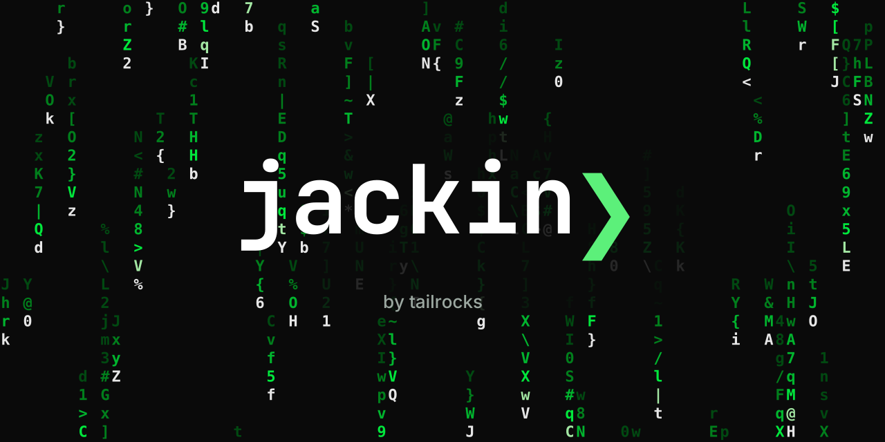

# jackin❯



> [!WARNING]
> jackin❯ is in active early development and is not production-ready. Expect breaking changes. Do not treat the current feature set as a compatibility promise.

Jackin is a command-line tool and a terminal console. It runs the Codex coding agent in [NVIDIA OpenShell](https://github.com/NVIDIA/OpenShell) sandboxes.

Jackin builds a container image for each role. It creates one sandbox for each launch, uploads your project into it, starts Codex, and attaches your terminal. OpenShell runs the sandbox and enforces the isolation. Your credentials stay on the OpenShell gateway.

Documentation: <https://jackin.tailrocks.com/>

## What it does

- Builds a role image with Docker BuildKit from a role repository: a `Dockerfile`, a `jackin.role.toml` manifest, and an OpenShell `policy.yaml`.
- Uploads your project as a working tree and a git bundle. Your host `.git` directory and your working tree stay untouched.
- Gives each sandbox a placeholder instead of your Codex login. The gateway holds the real token.
- Fetches the work of a sandbox back into your repository as git branches with `jackin export`.
- Tracks your accounts and shows the usage limits of each one with `jackin usage`.
- Gives a sandbox access to a Docker engine only when a role or a workspace turns on the Docker capability.

## Install

Jackin has no packaged release yet. Build it from source:

```sh
mise install
mise exec -- mbx +1.99.1 build -p jackin --release
```

The binary is `target/release/jackin`. You also need the `openshell` CLI, `ssh`, `git`, and `docker` with `buildx` on your host, and an OpenShell gateway that you run. See [Install jackin](https://jackin.tailrocks.com/getting-started/installation/) and [Run a local OpenShell gateway](https://jackin.tailrocks.com/guides/gateway/).

## Quick start

```sh
jackin gateway add jackin-local --default
jackin doctor
jackin role add my-role ~/roles/my-role
jackin account add codex --name work --chatgpt-from ~/.codex
jackin workspace add my-app ~/Projects/my-app
cd ~/Projects/my-app
jackin load my-role
```

Run `jackin` on a terminal to open the console. See the [Quick start](https://jackin.tailrocks.com/getting-started/quickstart/) for the full walkthrough and the [command reference](https://jackin.tailrocks.com/commands/reference/) for every option.

## Documentation

- [Why jackin](https://jackin.tailrocks.com/getting-started/why/)
- [Install jackin](https://jackin.tailrocks.com/getting-started/installation/)
- [Quick start](https://jackin.tailrocks.com/getting-started/quickstart/)
- [Core concepts](https://jackin.tailrocks.com/getting-started/concepts/)
- [Run a local OpenShell gateway](https://jackin.tailrocks.com/guides/gateway/)
- [Accounts](https://jackin.tailrocks.com/guides/accounts/)
- [Docker capability](https://jackin.tailrocks.com/guides/docker-capability/)
- [Security model](https://jackin.tailrocks.com/guides/security-model/)
- [Create a role](https://jackin.tailrocks.com/developing/creating-roles/)

## Ecosystem

| Repository | Description |
|---|---|
| [jackin](https://github.com/jackin-project/jackin) | The CLI and the console (this repository) |
| [jackin-agent-smith](https://github.com/jackin-project/jackin-agent-smith) | A code review role |
| [jackin-the-architect](https://github.com/jackin-project/jackin-the-architect) | A role with the Rust toolchain, for developing jackin |
| [jackin-sentinel](https://github.com/jackin-project/jackin-sentinel) | A role that proves jackin works end to end |

## Development

Read [CONTRIBUTING.md](CONTRIBUTING.md), [COMMITS.md](COMMITS.md), and [AGENTS.md](AGENTS.md). The target design is in [rewrite/DESIGN.md](rewrite/DESIGN.md).

## About this project

jackin❯ is an independent personal project by Alexey Zhokhov. It is not affiliated with or endorsed by any employer or client of the author.

## License

This project is licensed under the [Apache License 2.0](LICENSE).
