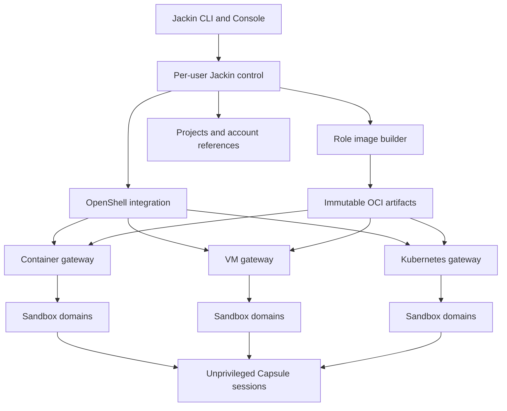

# Decision and product scope

Build Jackin v2 as a developer environment and session application over OpenShell. OpenShell is the sole execution control plane for agent sandboxes and independent verification workers. Jackin retains the product decisions that make a sandbox useful: reproducible roles, account selection, project context, interactive sessions, retained work, and convenient local and remote workflows.

Docker and Buildx remain trusted image-building infrastructure. They do not remain an alternative agent execution backend. Optional Docker API access is a separate, default-off workload capability with an explicit isolation and ownership contract.

The application is a clean rewrite around these boundaries. There is no Apple Container backend, Docker execution fallback, old-state importer, or legacy configuration parser. Users can adopt v2 through fresh configuration after removing their old runtime resources. Original project repositories and data protection remain product obligations.

The architectural direction is selected. Complete feature availability is conditional on the platform contracts in the dependency register below. In particular, managed Docker compatibility, strict verification-worker isolation, safe mutation fencing, and ordinary development with rebuilt network binaries require qualification or upstream changes. A design specification is not a claim that current stock OpenShell already satisfies them.

# Source baseline and evidence

The source review uses the following immutable references, verified on October 25, 2026:

| Component | Reference | Meaning |
| - | - | - |
| Jackin | `faa2ab6c12e3de45a76ab6b98df0c64dac7aac6e` | Current product source used to extract useful behavior. |
| OpenShell released baseline | `v0.1.5`, `bdb956f2cd65a635f1294fccf1d138d263bf650f` | Latest published release observed. |
| OpenShell development source | `c4688aa8715ea75d6c39fe468361dbbc16c691fa` | Includes changes absent from the release. |
| Experiment history | `a7689b48e2b6ef2ca5a4367ee27527887cf45ce8` | Attempted experiments, failures and candidate patches; not a capability authority. |

The supplied architecture reference provides the product direction. Current upstream source determines the runtime contracts. Experiment reports supply regression cases and leads that require independent verification. No new runtime experiment or production implementation was performed for this specification.

Two earlier assumptions need correction. Current OpenShell main implements Rust SDK mTLS through `ClientIdentity`; release v0.1.5 does not. Current Rust documentation still lags this code. Released Kubernetes uses separate supervisor and workload Pods. The newer shared-supervisor topology is development-branch behavior, not the initial deployment baseline. [S2][S3][S4]

# Architecture and ownership



The shared Capsule node represents the same workload software in each sandbox. It is not a shared service or a privileged supervisor.

| Responsibility | Owner | Boundary |
| - | - | - |
| Roles, selected agents, tools and plugins | Jackin | Versioned recipes and resolved artifacts. |
| Image build, validation and delivery | Jackin with Docker/Buildx and registry tooling | No agent access to the builder socket. |
| Gateway registration and connection credentials | OpenShell | Jackin references upstream registrations. |
| Sandbox creation, runtime restart and deletion | OpenShell | No Jackin Docker, Apple or Kubernetes execution controller. |
| Runtime filesystem, process and network enforcement | OpenShell | No second Capsule firewall, Landlock or privilege-switching system. |
| Provider injection and supported token refresh | OpenShell | Jackin chooses authorized account/provider bindings. |
| Project materialization, checkpoints and conflict handling | Jackin | Uses OpenShell transfer, exec and approved storage mechanisms. |
| PTY processes, output replay and session inventory | Capsule within one sandbox domain | Ordinary unprivileged workload software. |
| Approval UI, account selection, host effects and usage presentation | Trusted Jackin host control | Sandbox output cannot grant host authority. |
| Kubernetes scheduling and native resource reconciliation | OpenShell, Agent Sandbox and Kubernetes | No Jackin CRD, Pod controller or CNI. |
| Fleet presentation and application operations | Jackin | Observes runtime state; does not duplicate runtime reconciliation. |
| Managed optional engine | Proposed OpenShell companion capability | Upstream dependency, not a hidden Jackin sidecar manager. |

A small per-user host service coordinates local application operations, account leases and observations. It starts on demand and uses permission-protected local IPC with operating-system peer authentication. Local peer checks authenticate the desktop client, not a remote sandbox. Its death must not end a remote Capsule or its live PTYs. It is not a mandatory team server or a fleet scheduler. CLI and Console use the same application API.

# Product and domain model

The central composition is:

**Resolved role + project materialization + authority scope + target profile + account grant = execution domain.**

A logical Jackin instance groups the domains that belong to one developer work session.

| Entity | Definition |
| - | - |
| RoleRecipe | Versioned role source, Dockerfile/build context, tools, selectable agents, plugins, hooks and requested capabilities. |
| ResolvedRole | Immutable image artifact, platform, executable inventory, all resolved build inputs, Capsule protocol and provenance. |
| Project | Stable Jackin identity for source repositories, allowed local roots and development preferences. The familiar CLI can still call this a workspace. |
| Materialization | One concrete checkout, worktree, clone or snapshot with a baseline, storage owner and durability class. |
| TargetProfile | Reference to an existing OpenShell gateway, qualified runtime profile, builder and supported placement/storage/resource choices. |
| AuthorityScopeBinding | Explicit mapping to an OpenShell workspace whose members may exercise the domain's sandbox and provider authority. |
| Account | Stable account identity and credential-source reference; labels and email addresses are display values. |
| AccountGrant | Authorized account, agent, scope, credential revision and lifetime for a domain or run. |
| Instance | Logical developer session grouping role, purpose, project and one or more domains. |
| ExecutionDomain | One account/capability/policy trust set, implemented by one OpenShell sandbox. |
| SandboxBinding | Gateway identity, OpenShell workspace, canonical name, immutable sandbox ID and observed runtime generation. |
| Session | One agent or shell PTY within a domain and Capsule boot. |
| Attachment | Temporary client connection, replay cursor, geometry and optional input-writer lease. |
| Operation | Durable application intent, resolved inputs, request IDs, phase, receipts and recovery disposition. |

Use typed IDs throughout Rust code. Resolve human selectors at the UI boundary. An ambiguous selector must produce a selection error, not select the first matching role. Generate canonical sandbox names once and never reuse them. Friendly aliases remain separate.

## Domains and account isolation

Sessions can share a sandbox only when they share the intended credential, policy, writable-data and trust context. Separate environment dictionaries or home directories do not isolate same-UID processes.

A different account, credential exposure, policy, tenant or trust class creates another domain. A generic project shell is credential-free and runs in a separate domain by default. An explicitly requested shell inside an agent domain inherits that domain's privileges and must be labelled accordingly.

The Console can show all these panes as one logical instance. It must not force a one-container-shaped interface onto the user.

Distinct domains default to independent writable materializations. A shared writable project can carry malicious edits into another credentialed agent's build or configuration. Shared writable source is therefore an explicit collaboration trust decision, not proof of account isolation.

## OpenShell workspace authority

OpenShell workspaces are access and resource scopes, not project directories. Workspace Users can exercise sandbox and provider use across their workspace. Separate sandboxes inside the same workspace do not make an account private from other authorized members. [S5]

Each domain resolves an authority scope independently. A project can have a private owner scope and a deliberately shared team scope on the same target. Do not force every account domain into one project-wide OpenShell workspace. Private credentials require membership restricted to principals authorized to use them.

Jackin account leases coordinate this installation. They cannot restrict another laptop, a direct OpenShell client, or an administrator. Mandatory authorization must remain upstream. Native file-login exceptions need an explicit single-writer deployment scope. Reject unsupported cross-device sharing of rotating refresh state until a qualified shared authority exists; do not invent a generic refresh broker to hide the limitation.

# Roles and reproducible image construction

Keep launch-time image building. `load` resolves the role and its inputs, reuses an exact valid artifact or builds one, delivers it, then creates the sandbox through OpenShell.

For the initial v2 model, a resolved role image contains its complete declared selectable agent set. Validate every advertised executable. This supports agent switching and new sessions without pretending an unavailable binary is installed. A future reduced image variant must have an explicit installed-agent set, separate identity and clear UI behavior.

The cache key includes role revision, build context under actual ignore rules, Dockerfile, base-image digest, platform, every declared agent/tool/plugin version, hooks, nonsecret build arguments, Capsule artifact and schema. Unknown versions cannot silently share a reproducible cache key. Secret contents never become image layers or ordinary logs; builds with secret-dependent output need an explicit cache policy.

Keep local engine image IDs, OCI image manifests and OCI multi-platform indexes as different types. A local Docker image ID is not a remotely pullable registry reference. Resolve and record the actual platform artifact.

Bind each build plan to an explicit builder endpoint and context. Ambient `DOCKER_HOST` must not silently redirect source or build secrets. Use same-engine image delivery as a local fast path. V2 standardizes remote delivery on a reachable registry with immutable image references and scoped pull authorization. Record an approved multi-platform index and its selected platform manifest separately. Verify that the executed artifact is the one the build produced. OpenShell's image input does not build Dockerfiles for Jackin. [S6]

Version detection uses verified artifact metadata or an OpenShell execution. Do not retain direct `docker run` probes because they happen to reside in the image subsystem.

Separate builder cache ownership, registry retention, OpenShell prepared-image caches and artifacts required for recreation. Pruning must not infer image liveness from old Docker role-container labels.

## Portable role ABI

Role images are ordinary Linux OCI images. They contain application tools, agent binaries, plugins, Capsule and explicit unprivileged hooks. OpenShell supplies its own trusted runtime and supervisor.

| Item | v2 contract |
| - | - |
| Identity | Named `sandbox` account with nonzero UID/GID; support the actual qualified gateway-assigned identity. |
| Work directory | Standard `/sandbox`; actual project at `/sandbox/project`. |
| Session and agent state | `/sandbox/.jackin`, private to the domain. |
| Cache | Scoped directories below `/sandbox/cache`, with separate retention and quotas. |
| Tools | Installed during build; root-owned executable assets with suitable read/execute permissions. |
| Runtime setup | Explicit nonprivileged command, with no chown, sudo, setuid, namespace or firewall requirement. |
| Environment | Explicit HOME/XDG/tool paths and filtered account variables. |
| Compatibility | Declared agent, Capsule protocol, architecture, filesystem, network and syscall requirements. |

Do not assume arbitrary OCI USER, WORKDIR or ENTRYPOINT behavior is identical across drivers. VM identity resolution and workdir differ from container drivers. A role requiring a fixed UID or unsupported syscall is rejected by an incompatible target. [S7][S8]

Operator-managed workload templates can provide approved runtime shapes. They do not replace RoleRecipe, and they do not inherently impose a policy ceiling. Their inline-image restrictions must be respected. Personal development can use an admitted inline image spec; curated shared targets can publish approved template revisions through their operator workflow. Jackin must not acquire an administrator credential merely to hide this distinction. [S9]

# Capsule v2 and persistent sessions

Capsule becomes an unprivileged, resident session service. OpenShell launches it as the canonical workload. The initial interactive profile explicitly selects the upstream `Never` canonical restart policy. Capsule starts with zero agent sessions and waits for explicit activation. Agent-child exit finishes that session while Capsule stays alive. A Capsule failure ends that process incarnation; recovery never automatically replays old agent-start commands. A new boot requires a new activation epoch and completed materialization.

StartSession is permitted only after the host has recorded the materialization receipt, current account-grant generation, compatible Capsule boot, and authoritative acceptance/readiness of the required policy and provider configuration. Missing required observations block activation. SandboxReady or a helper receipt alone is insufficient.

Capsule owns PTY creation, terminal sizing, process-group signals, child reaping, session inventory, bounded replay, terminal snapshots and advisory agent events. It does not own account authorization, provider inventories, gateway credentials, enforcement, host effects or runtime recreation.

Remove v1 root PID1 setup, UID switching, ambient DAC capabilities, Capsule Landlock/firewall enforcement, sudo provisioning and Linux peer-PID proofs. Preserve useful terminal parsers, layouts, command construction and status logic only after reviewing their preconditions. Current source illustrates why preserving the old Capsule binary is not the right abstraction. [S10]

## Transport

Start canonical `jackin-capsule serve` independently of an attachment. For each attachment, OpenShell interactive exec starts a short-lived `jackin-capsule relay --stdio` process. The relay connects to Capsule's local socket.

The outer exec uses `tty=false`, `no_login_shell=true`, and the absolute installed relay executable path. It carries bounded binary protocol frames, with diagnostics on stderr. Capsule creates the inner PTYs. Relay cancellation or EOF must close the attachment without ending the resident Capsule or its PTYs.

Reconnection creates a new relay and a new upstream exec request ID, then attaches to the same application session. OpenShell execution admission replay is not terminal stream replay. Reusing an old exec ID does not reattach or reconstruct output. [S11]

## Protocol and authority

Use a versioned, length-delimited protocol with explicit frame limits and capability negotiation. Core operations are inspect, start/stop session, attach/detach, resize, input and snapshot. Events carry output, exit, replay gap and advisory status.

Each Capsule boot gets a new boot ID. Each session has a host-assigned ID and a command operation ID. StartSession deduplicates within the current boot. A helper identity echo detects mismatches; it is not trusted attestation. OpenShell/operator observations establish runtime identity, accepted policy and isolation posture. Helper receipts establish protocol compatibility and application progress only. Missing authoritative upstream observations remain explicit limitations.

Output has a monotonic sequence and bounded retention. A terminal snapshot has a sequence watermark. Slow clients receive an explicit replay-gap event rather than silently missing data or blocking PTY draining. Durable terminal transcripts are opt-in because output can contain secrets.

Multiple viewers are allowed. One attachment holds the input-writer lease. Lease changes increment an attachment generation so stale input is discarded. Do not replay unacknowledged keystrokes automatically after connection loss. An input acknowledgment does not prove completion of an arbitrary shell command.

Capsule shares its UID with the workload. A compromised agent can tamper with its helper. Its events and terminal output are untrusted data. Trusted labels, approval dialogs, clipboard access, host URL opening and export destinations remain on the host. Host effects require a corresponding local operator action and scoped request correlation.

## Persistence semantics

| Event | Contract |
| - | - |
| Client detach or terminal close | Live PTYs continue while Capsule and sandbox survive. |
| Network interruption | Observation becomes stale; reconnect to the existing binding and replay/snapshot where available. |
| Local host-service failure | Remote execution continues; pending local operations recover from the journal. Host-dependent approval services can be unavailable. |
| Gateway interruption | Do not infer workload death; runtime-specific recovery applies. |
| Capsule restart | Old PTYs are lost. A new boot starts with zero agent sessions. |
| Sandbox stop/start or replacement | New process incarnation; retained files may permit agent-specific resume. |
| Cross-target handoff | New sandbox and PTY from a verified checkpoint, with new authority admission. |

Persistent PTY, saved agent conversation and project checkpoint are three different features. No live process-memory migration is promised.

# Workspace materialization and retention

Keep source isolation separate from transport.

| Axis | Choices |
| - | - |
| Source isolation | Shared working tree, Git worktree, isolated clone. |
| Data transfer | Trusted local bind, snapshot import, Git fetch and checkout. |
| Storage backing | Workload layer, managed volume, VM overlay, PVC, or approved external storage. |
| Retention | Disposable cache, sandbox-retained state, externally retained checkpoint. |
| Collaboration | Independent branches by default; explicitly trusted shared write access when required. |

A worktree can be transferred as a self-contained snapshot for remote use. Do not ship broken host `.git` links or describe an archive as a live mount. The source manifest records Git base, chosen dirty/untracked files, exclusions, content digest and ownership. Stage each materialization under a unique epoch, verify it, then activate it. Partial staging is never active. General project transfer excludes account stores and credentials. Live binds have a separate contract and do not promise snapshot atomicity.

Use conflict-aware export and apply. Returned changes include their baseline. A host checkout changed after launch must not be overwritten blindly. Remote work normally returns a branch, patch or artifact through an explicit action. Transparent bidirectional synchronization is not a v2 foundation.

Keep trusted live local editing as a separate target profile. Existing live Shared/Worktree workflows map to that profile; snapshot mode must not silently replace their live-edit behavior. Raw binds require operator opt-in and disable OpenShell external-resource label admission. Bind source paths refer to the relevant runtime host, which may differ from the CLI laptop. [S7]

Isolated VM profiles use guest-owned storage and transfer/Git materialization. They prohibit raw host-directory binds. Live host sharing requires a different trusted-local profile and does not retain the isolated-VM guarantee. The documented virtiofs implementation does not confine a compromised guest kernel to the selected source directory. Broadening a mount to fit the VM mount budget is not acceptable isolation. [S7]

Kubernetes initially uses its automatic persistent `/sandbox` workspace. Any explicit mount beneath `/sandbox` can disable that injection; alternate storage layouts need complete qualification. Existing PVC content is not automatically refreshed by changing the role image. Sandbox deletion can delete its owned storage. External volumes/PVCs have their own owners and must not be treated as disposable by assumption. [S4]

Before destructive operations, preserve the required project and conversation checkpoint outside the resource being deleted. A retention plan names the independently recoverable checkpoint, its storage owner and deletion rules. A local retention record cannot protect a PVC from external Sandbox deletion. Git alone does not preserve untracked files or agent session state. Checkpoints exclude credentials and unrequested host data. VM flush errors, interrupted transfers and uncertain cleanup are visible outcomes, not successful persistence receipts.

| Runtime storage | Stop and start | Delete or recreate |
| - | - | - |
| Docker/Podman workload layer | Retained with the same workload container. | Removed with that container; no automatic copy to its replacement. |
| Podman managed workspace volume | Retained. | Driver-owned volume follows deletion. |
| VM overlay | Retained; processes restart. | Deleted with the sandbox; independent checkpoint required. |
| Kubernetes automatic workspace PVC | Retained across stop/start and Pod replacement. | Owned storage follows Sandbox deletion. |
| Approved externally owned volume/PVC | Qualified attachment and reuse rules apply. | External retention owner decides; neither automatic deletion nor automatic backup is assumed. |

## Handoff

Quiesce source writers through a supported application mechanism, record a consistent checkpoint, transfer it with checksums, admit an independently authorized destination, materialize and verify, then resume an agent-supported conversation. Retire the source only after destination acceptance. A failure leaves the last accepted checkpoint available. Do not assume stop/start is a process-preserving freeze or that duplicate agent side effects are impossible.

# Credentials, account state and policy

Prefer OpenShell providers for compatible HTTP credential substitution and gateway-side refresh. Jackin maps a selected Account to an explicit provider or native-login route; these are different entities.

Provider substitution is endpoint-bound and depends on inspected protocol support. Opaque non-HTTP tunnels do not gain it automatically. Possession of a placeholder can still authorize real upstream actions even when the application cannot read the secret bytes. [S12]

Native subscription/OAuth clients can require real credential files. Such state is an explicit credential exposure within one private domain. Capsule's lack of credential authority does not make those files unreadable to same-UID processes. Never copy the entire host home, `.ssh` tree or all-account credential store. Stage only admitted files; use atomic publication, version checks and one refresh writer where rotating token state requires it.

Saved instance account selection is stable. Reconnect must not replace it with the user's current default account. Account revision changes cause re-admission, not silent reassignment.

Keep account usage and quota interpretation in trusted Jackin logic or an explicitly deployed trusted service. Key caches by stable account and credential/source revision. Report unavailable and stale data distinctly from zero usage. Deny delayed requests from ended runs and prevent unrelated account enumeration.

Jackin can retain an approved tool-action workflow for credentials that native OpenShell provider paths cannot handle. It does not introduce a parallel generic credential store. Approval binds the requesting domain, normalized operation, fixed tool/image identity, arguments, selected input digests, destination scope, expiry and replay identity. A material change invalidates it. A separate OpenShell execution domain receives only the necessary capability or secret under the selected mechanism. Agent shell strings, project hooks and writable configuration cannot select its worker executable or credentials. Do not inject such secrets into the coding-agent PTY or execute an arbitrary agent script in a privileged host shell. Secret non-disclosure cannot be claimed for a consumer that actually receives the secret.

## Policy ownership

Role authors declare requirements. Project settings provide defaults. The authorized operator owns the final grant. Jackin uses OpenShell's native policy format and provider profiles; it does not maintain another network policy engine.

Store requested policy identity, observed effective policy source/revision and provider bindings. Provider rules can add effective access. A global policy replaces sandbox policies; policy layers do not always intersect. Loaded policy revision, not just a submitted document, determines the observation. Network updates close existing connections, while startup filesystem/identity changes require recreation. [S13]

Client preflight is useful UX, not enforcement against direct OpenShell callers. Mandatory ceilings belong in gateway configuration/admission. Changes that invalidate an active domain's requirements must be reported and handled by the declared policy, rather than silently weakening isolation.

# Target profiles and Kubernetes deployment

One OpenShell gateway selects one compute driver. Jackin target profiles reference that gateway and add product choices. Project/target authority bindings select the actual workspace. Local target UUID, registration alias, configured gateway name and verified TLS/server identity are distinct records; no globally immutable upstream gateway UUID is invented. Every operation carries its explicit gateway and workspace. Concurrent commands must never switch the globally active gateway to route requests. [S14]

| Profile | Runtime and storage | Intended promise |
| - | - | - |
| `dev-container` | Qualified OpenShell Docker; snapshot/Git project; approved storage | Default portable coding environment. |
| `trusted-live-local` | Separate personal Docker gateway with explicitly admitted host binds | Fast host-editor workflow with the documented trust tradeoff. |
| `isolated-vm-small` and `isolated-vm-large` | Qualified OpenShell VM gateways; guest storage; no raw host binds | Stronger kernel boundary with visible fixed resource shape. |
| `team-kubernetes` | Official OpenShell deployment, Agent Sandbox, dedicated supervisor, qualified CNI and storage | Shared remote infrastructure with explicit authority scopes. |
| `verification` | OpenShell worker with strict read-only inputs/root and bounded scratch | Independent checks, gated on required runtime support. |

Optional engine access is a separately admitted capability on qualified profiles. Unsupported targets reject it before launch. No requested VM boundary is silently downgraded to a container.

VM vCPU, RAM and overlay settings currently belong to gateway configuration and apply to each VM. Generic per-sandbox CPU/memory requests are accepted but ignored by this driver. Fixed-size target profiles are the supported design until upstream provides request-level sizing. ARM64 and x86_64 mount limits also differ. [S8]

## Kubernetes ownership and deployment

Use official OpenShell Helm resources and the Kubernetes SIG Agent Sandbox controller. Released OpenShell creates the Sandbox resource and paired supervisor infrastructure; Agent Sandbox owns the workload Pod. Jackin does not create Pods or implement another operator. [S4]

Use dedicated supervisor topology initially. Qualify gateway/chart, supervisor image, trusted runtime image, Agent Sandbox version, CNI, node kernel/runtime, StorageClass, architecture and role ABI as one compatibility tuple. Do not silently mix development and release components.

Use operator-managed namespaces for deliberate team authority scopes. A project can require more than one scope when some accounts are private. Native cluster RBAC remains powerful even in operator namespace mode; treat each gateway installation as an administrative trust boundary. Use separate gateways or clusters for materially different trust classes.

Enforce both ingress and egress NetworkPolicy. Prevent untrusted mutation of Sandbox resources, Pods, bootstrap Secrets, service accounts and permissive network policies. The existence of a policy object is not enforcement evidence. Ordinary developers use scoped OpenShell identity, not direct administrative access to sandbox namespaces.

Use explicit storage classes, quotas, image-pull credentials and tested resource profiles. No agent receives the physical host Docker socket or a Kubernetes token with Pod-creation authority. Provider-private state is not placed in a shared team PVC.

Use upstream gateway HA with PostgreSQL and authenticated peer routing when needed. Do not invent a Jackin relay scheduler. HA does not preserve an interrupted transport stream or replace database/workspace backup. [S15]

## Developer services

Private dev servers use authenticated OpenShell forwards bound to local loopback. The sandbox service binds its permitted local interface. Jackin owns the convenient URL and forward lifetime.

Public service exposure is a separate explicit capability. OpenShell service URLs bypass control-plane RPC authorization and OIDC/CLI login; listener TLS, application authentication and edge policy are separate concerns. Do not expose Capsule control through such a URL. [S6]

# Optional Docker capability

Role image construction and agent-controlled Docker are separate features. A build-only service cannot replace Docker run, Compose or Testcontainers.

The selected target design is a **dedicated disposable engine VM per admitted execution domain**, owned by OpenShell as a companion resource. The agent stays in its ordinary sandbox. It receives only the domain's authenticated engine endpoint. The companion has private engine storage and a confined projection of approved project data.

Full Docker API access grants broad administrative authority over the daemon's machine. Therefore, do not colocate a rootful daemon with the agent guest's trusted runtime. Do not expose the developer's physical-host engine. A separate engine VM bounds that authority to disposable compute and approved data.

This is proposed upstream capability, not a shipped OpenShell feature. Current child seccomp blocks the namespace, mount and privilege operations needed by ordinary nested rootless Docker. Installing Docker binaries does not change that boundary. VM lifecycle hooks are a possible implementation insertion point, not a completed engine service. [S16][S17]

The first engine-enabled profile targets an OpenShell VM gateway with the proposed companion extension. Released ordinary profiles advertise no managed-engine capability. The grant is fixed at domain creation. Enabling it later checkpoints and reprovisions onto a qualified engine-enabled target. Other compute drivers acquire this capability only after their own upstream integration passes the same contract. Connecting to an engine endpoint does not change a gateway's compute-driver capabilities.

The companion contract must cover:

- Explicit admission; no engine, endpoint, credentials or engine prewarm when disabled.

- Owner sandbox/domain identity and generation-bound, revocable access.

- Docker API streaming, build, exec, logs, events and Compose compatibility.

- Outer-enforced egress for daemon, build steps and child containers.

- Confined daemon-side project paths, live edit/rename/watch behavior and result ownership.

- Reachable dynamic published ports and Testcontainers service-host discovery.

- Aggregate CPU, RAM, PID, disk and network budgets for the engine and all children.

- Durable creation, restart, stop, deletion and orphan reconciliation under OpenShell ownership.

- Confirmed cleanup after parent failure and interrupted provisioning.

The ordinary VM has no external NIC. A guest-init script alone cannot provide online pulls, Docker child routing or secure port publication. These are required parts of the extension. No raw virtiofs host sharing is accepted as the isolated project projection. The engine sees only the admitted project at its agreed absolute path; account state and OpenShell control data are excluded. This capability-internal projection is separate from host source import/export. It must define concurrent writes and file-watch behavior. Build-context streaming alone does not establish Compose bind compatibility.

Docker children do not automatically inherit the agent's binary-level policy. The engine VM needs its own outer boundary. External daemons may be used in isolated integration research, but they are outside the supported v2 managed-engine contract and are not a runtime fallback.

Bind ownership to the parent sandbox's immutable identity, authorized scope and capability revision. Per-start access credentials bind the current runtime generation. Stop terminates companion services and revokes old endpoints. Start reuses only explicitly retained domain data with new authenticated access. Sandbox recreation obtains a new engine. Delete completes only after companion destruction and revocation are confirmed. Uncertain cleanup remains pending. Shared engine pools are outside the initial contract.

This is a release blocker for complete Docker-enabled v2. Preserve the capability requirement instead of disguising the old Jackin DinD manager as an OpenShell integration.

# Independent verification workers

Use a separate OpenShell sandbox with no coding-agent account, no ordinary network access, immutable candidate source and a separate trusted check bundle. Execute the approved command under bounded memory, CPU, PIDs, scratch storage, output and deadline. Bind results to candidate, image, command and check-bundle digests.

This worker is distinct from an agent's development test session. Host product logic owns policy and verdict recording. OpenShell owns worker execution and authoritative runtime observation.

Current Docker driver source makes the supervisor root read-only but does not set read-only root for the workload. Its caller configuration does not expose a general workload root-read-only option. Landlock content restrictions do not establish full filesystem metadata immutability. Strict worker support therefore requires an upstream contract for read-only root, bounded writable control/scratch paths and trustworthy completion. [S18]

Do not retain the direct Docker workflow worker, host execution fallback or an image-internal permission approximation presented as the same guarantee.

# Application operations and failure handling

Keep three state categories separate:

| Category | Examples | Authority |
| - | - | - |
| Application operation | Resolving, building, creating, materializing, activating, complete, failed, outcome unknown | Jackin journal. |
| Runtime observation | Provisioning, ready, stopped, deleting, failed; observed generation | OpenShell. |
| Session and agent observation | Live session, exited, working, blocked, idle, replay gap | Capsule/agent data, with source and freshness. |

Use transactional local storage with one write coordinator. Do not hold database write transactions across network calls. Store credentials separately from ordinary records.

Persist canonical operation inputs and mutation request IDs before effects. Replay only according to the upstream contract. A lost exec response does not justify launching the command again with a new ID. A new relay attachment is different from a retry of the previous execution.

The public API addresses many operations by workspace and name. Unique names and one Jackin writer reduce accidental races, but read-then-mutate is not atomic. Strict identity safety needs server-side expected sandbox ID and applicable generation preconditions for each effectful operation. A delete-only patch does not solve stop, start, exec or policy races. [S11]

Keep uncertain operations visible. Authentication failure, permission masking, unreachable gateway and incomplete pagination are not resource absence. Do not purge retained data from a generic NOT_FOUND response without establishing the expected authorized scope and ownership.

OpenShell remains responsible for runtime restart and infrastructure reconciliation. Jackin must not create replacement sandboxes merely because an observation timed out. Cleanup is a journaled product operation with explicit retention rules and receipts.

## Command semantics

| Command or action | v2 behavior |
| - | - |
| `load` | Resolve, build or reuse, deliver, materialize, admit, activate and attach. |
| `hardline` | Attach to a surviving session; offer explicit new-process resume when only retained state remains. |
| Detach | Release attachment/input ownership; keep execution. |
| Interrupt | Signal the selected session; do not stop unrelated domains. |
| `eject` | Stop all selected instance domains while retaining documented project and resumable state. |
| `exile` | Bulk eject within explicit target/project scope. |
| `purge` | Remove owned runtime and selected retained data after guards; never delete the original user checkout or shared providers implicitly. |
| `checkpoint` | Produce a verified non-secret project/agent-state recovery artifact. |
| `handoff` | Recreate from a checkpoint in an independently authorized destination. |
| `doctor` | Distinguish builder, gateway, target, optional engine and host problems. |

An unavailable separate builder must not disable status or OpenShell management. This does not mean that a gateway survives loss of the same physical engine that hosts it.

# Fleet view and developer experience

Keep familiar roles, workspaces, load/hardline/eject vocabulary, terminal panes, selected accounts, usage, branch/PR context, clipboard images and file export. Move their implementation onto the new model.

The Console groups by project, logical instance, domain and session. It displays target and scope, runtime state, agent activity, active account, policy profile, storage mode, resource budget and observation age. Use trusted host labels. Agent-reported done/idle does not authorize deletion or establish a verification verdict.

Aggregate authorized scopes with bounded concurrency, pagination and per-target deadlines. Preserve stale rows with last-seen times during outages. Show completeness, such as two of three targets reachable. Cross-workspace list permission is not assumed for ordinary users.

Initial placement is explicit. Later placement can choose among authorized qualified targets. Kubernetes still schedules Pods; OpenShell still owns sandbox execution. Team queues, multi-user job ownership and general agent collaboration are later product features, not prerequisites for the core desktop redesign.

Collaboration starts with branches, checkpoints, artifacts and explicitly authorized service/MCP access. Do not distribute gateway administrator credentials to agents or assume shared writable state is a safe collaboration protocol.

## Proposed command examples

These are v2 examples, not claims about current CLI syntax.

```sh
jackin target list
jackin load the-architect --project payments --target local --agent codex --account work
jackin hardline <instance-id>
jackin shell <instance-id>
jackin shell <instance-id> --in-domain <domain-id>
jackin console --all-targets
jackin inspect <instance-id> --json
jackin checkpoint <instance-id>
jackin handoff <instance-id> --target team --checkpoint <checkpoint-id>
jackin eject <instance-id>
```

# Rust architecture and configuration

Use two applications: `jackin` for CLI, Console and per-user control; `jackin-capsule` for the workload session service and relay. Keep the crate graph substantially smaller than the historical backend structure.

| Group | Crates or modules | Responsibility |
| - | - | - |
| `crates/core` | domain, config, session-protocol | Typed IDs, validation, strict schemas, bounded wire protocol. |
| `crates/services` | control, roles, workspaces, accounts, sessions | Application workflows and product decisions. |
| `crates/adapters` | openshell, buildx, state, agent integrations | External APIs, Docker building, SQLite and agent-specific behavior. |
| `crates/apps` | jackin, jackin-capsule | Host UX/control and unprivileged workload process. |

The pure model does not import OpenShell protobufs, Docker types or SQLite records. Generated upstream types do not become the durable Jackin schema. One OpenShell adapter contains version negotiation, explicit scopes, SDK/raw RPCs, error mapping, file transfer and relay creation. No public Docker/Apple/OpenShell backend enum remains.

Prefer upstream Rust SDK transport from a qualified release containing mTLS support. A development pin with that support must be labelled and tested with the selected gateway. If v0.1.5 is used, isolate the narrow custom channel requirement; do not build a permanent replacement authentication stack. Raw streaming and explicit request IDs remain necessary where curated helpers do not provide the required behavior. [S2][S3][S11]

Suggested application operations are ResolveLaunch, StartInstance, InspectOperation, CreateSession, AttachSession, StopSession, Eject, Checkpoint, ApplyChanges and Handoff. Each effectful call carries an operation ID and typed immutable references. Error classes distinguish authentication required, permission denied, unsupported capability, identity changed, conflict, runtime failed, transport unavailable, outcome unknown and session lost.

Keep user, role and project configuration separate. Use a strict v2 TOML schema with unknown-field rejection and credential references. Native OpenShell policies remain native policy documents. This avoids a second security DSL.

The following is an illustrative Jackin schema:

```toml
schema_version = 2

[builders.local]
kind = "docker-buildx"
context = "desktop-linux"

[targets.local]
gateway = "openshell-local"
profile = "dev-container"
builder = "local"

[targets.team]
gateway = "engineering-cluster"
profile = "team-kubernetes"
builder = "local"
registry = "registry.example.com/agent-environments"

[projects.payments]
repository = "https://github.com/example/payments.git"
source_isolation = "worktree"
default_target = "local"
default_scope = "private"

[projects.payments.bindings.local.private]
openshell_workspace = "personal-dev"

[projects.payments.bindings.team.private]
openshell_workspace = "personal-dev"

[projects.payments.bindings.team.shared]
openshell_workspace = "payments-team"

[projects.payments.presets.engineer]
role = "the-architect"
agent = "codex"
account = "work"
docker = false
```

These names are examples, not new OpenShell settings. Gateway authentication remains in the upstream registration/credential system. Scope bindings must exist and be authorized; TOML cannot grant access.

# Performance and resource contracts

Report requested resources, enforced scope, reserved capacity and measured consumption separately. Docker workload limits exclude its supervisor CPU/memory overhead. Podman constructs separate resource scopes. VM memory and vCPU settings cover the guest, not host supervisor, gateway or image preparation. [S18][S19][S8]

Logical instance cost includes all its account domains, generic-shell domain, supervisors, agents, caches and optional engine VM. Per-account isolation has a real resource cost. Start extra domains lazily and reuse only domains with identical admitted trust context. Never merge account domains merely to save RAM.

Instrument the launch critical path: resolution, cold/warm build, transfer, image preparation, sandbox readiness, materialization, Capsule readiness and first useful agent output. Measure attach/reconnect, file-watch latency, incremental build/test, checkpoint, stop and cleanup separately.

Record host/kernel/architecture, exact artifacts, cache conditions, sample count, median and range. Report meaningful percentiles only with adequate samples. Separate sparse virtual disk size from allocated bytes and VM configured RAM from host RSS. No startup-time or memory figure is asserted by this source audit.

Prewarm immutable tools and images, with bounded concurrency. Do not attach accounts or start a default-off engine during ordinary prewarm. Cache correctness precedes startup optimization.

# Dependency register and qualification gates

| Contract | Current source or evidence | Required decision before a complete release |
| - | - | - |
| Rust mTLS | Implemented on current main; absent from v0.1.5 SDK. | Pin and qualify a consistent integration baseline containing upstream support. |
| Managed Docker companion | No shipped generic engine service; ordinary nested daemon syscalls denied. | Upstream engine VM lifecycle, data/network/port/resource and cleanup contract. |
| Strict verification worker | Workload read-only root is not exposed by current Docker driver. | Upstream read-only root and bounded control/scratch design with negative metadata/content tests. |
| Identity-safe mutations | Public APIs are primarily name/workspace addressed. | Expected immutable ID and generation protection for relevant mutations; no fake client-side atomicity. |
| Rebuilt network programs | Experiment history records failures; source assumptions require qualification. | Ordinary repeated Cargo/nextest/Testcontainers under intended profiles, with safe executable-identity lifecycle. |
| Debugging and profiling | Child filters block ptrace, cross-process memory and perf/BPF facilities. | Declare unsupported initially or obtain an upstream-qualified capability; installation alone is not support. |
| Complete session/account model | Proposed unprivileged Capsule and domain split. | Combined real-agent, two-account, shell, host-action and recovery acceptance tests. |
| VM and remote target behavior | Driver-specific identity, sizing, storage and networking. | Full target qualification, no inference from one local compiler example. |
| Kubernetes deployment | Released dedicated topology depends on actual cluster enforcement and storage. | Qualified complete deployment tuple and failure/recovery tests. |

Qualification includes default-off negatives, wrong-domain denial, private scope access, partial target failure, same-name replacement, lost responses, dirty/unpushed work, actual image identity and unrelated-resource preservation. Treat historical experiments as regression fixtures; run current versions before closing a gate.

# Implementation sequence

1. **Freeze contracts and upstream dependencies.** Publish the domain model, role ABI, authority scopes, target qualification format and session/persistence semantics. Prove the blocking OpenShell assumptions with minimal tests. Pursue targeted upstream changes rather than creating a private parallel runtime.

2. **Build one native vertical path.** Strict v2 config, typed IDs, upstream gateway resolution, correct image build/delivery, one OpenShell domain, unprivileged Capsule and real-agent attach/reconnect. Keep this a v2 branch or separately versioned application.

3. **Complete project and account workflows.** Materialization, private domains, providers/native-login adapters, saved account selection, usage, checkpoint, conflict-safe apply and normal retained-state recovery.

4. **Complete product control and UX.** Host-owned panes/actions, status/PR/CI, input ownership, journal recovery, scoped ejection/purge, image liveness, prewarm, doctor and fleet observations.

5. **Integrate optional engine and verifier contracts.** Use the qualified upstream mechanisms. Remove every remaining direct Docker execution path, including version probes and independent workflow workers.

6. **Qualify local VM and remote deployments.** Linux, macOS, intended desktop engines, remote gateways and Kubernetes; then failure injection, scale/resource measurement, packaging and documentation.

7. **Release v2 after complete workflow acceptance.** Document fresh setup and changed command semantics. Retire old backend code and configuration formats. Keep a tested OpenShell compatibility matrix and an explicit upgrade policy.

Each slice should demonstrate a real user journey. An intermediate demonstration is not full replacement approval. A temporary OpenShell patch has a pinned diff, isolated ownership, upstream plan and regression tests; it must not quietly become a second Jackin runtime.

# Primary source references

- [S1] [OpenShell v0.1.5 release](https://github.com/NVIDIA/OpenShell/releases/tag/v0.1.5), [current Jackin source](https://github.com/jackin-project/jackin/tree/faa2ab6c12e3de45a76ab6b98df0c64dac7aac6e), [experiment history](https://github.com/donbeave/openshell-jackin-poc/tree/a7689b48e2b6ef2ca5a4367ee27527887cf45ce8).

- [S2] [Current SDK client identity](https://github.com/NVIDIA/OpenShell/blob/c4688aa8715ea75d6c39fe468361dbbc16c691fa/crates/openshell-sdk/src/config.rs) and [TLS implementation](https://github.com/NVIDIA/OpenShell/blob/c4688aa8715ea75d6c39fe468361dbbc16c691fa/crates/openshell-sdk/src/transport.rs).

- [S3] [Released SDK configuration](https://github.com/NVIDIA/OpenShell/blob/bdb956f2cd65a635f1294fccf1d138d263bf650f/crates/openshell-sdk/src/config.rs).

- [S4] [Released Kubernetes driver](https://github.com/NVIDIA/OpenShell/blob/bdb956f2cd65a635f1294fccf1d138d263bf650f/crates/openshell-driver-kubernetes/README.md).

- [S5] [Workspace roles and scope](https://github.com/NVIDIA/OpenShell/blob/c4688aa8715ea75d6c39fe468361dbbc16c691fa/docs/how-it-works/workspaces.mdx).

- [S6] [Images, execution, services and transfer](https://github.com/NVIDIA/OpenShell/blob/c4688aa8715ea75d6c39fe468361dbbc16c691fa/docs/how-it-works/sandboxes/overview.mdx).

- [S7] [Runtime mount and identity contracts](https://github.com/NVIDIA/OpenShell/blob/c4688aa8715ea75d6c39fe468361dbbc16c691fa/docs/how-it-works/sandboxes/runtimes.mdx).

- [S8] [VM driver configuration and lifecycle](https://github.com/NVIDIA/OpenShell/blob/c4688aa8715ea75d6c39fe468361dbbc16c691fa/crates/openshell-driver-vm/src/driver.rs).

- [S9] [Native workload templates](https://github.com/NVIDIA/OpenShell/blob/c4688aa8715ea75d6c39fe468361dbbc16c691fa/docs/how-it-works/sandboxes/templates.mdx).

- [S10] [Current Capsule ownership](https://github.com/jackin-project/jackin/blob/faa2ab6c12e3de45a76ab6b98df0c64dac7aac6e/crates/apps/jackin-capsule/README.md), [control authorization](https://github.com/jackin-project/jackin/blob/faa2ab6c12e3de45a76ab6b98df0c64dac7aac6e/crates/apps/jackin-capsule/src/daemon/control/auth.rs), [Linux isolation](https://github.com/jackin-project/jackin/blob/faa2ab6c12e3de45a76ab6b98df0c64dac7aac6e/crates/apps/jackin-capsule/src/process_isolation/linux/enforce.rs).

- [S11] [Public RPC contract](https://github.com/NVIDIA/OpenShell/blob/c4688aa8715ea75d6c39fe468361dbbc16c691fa/proto/openshell.proto), [SDK client behavior](https://github.com/NVIDIA/OpenShell/blob/c4688aa8715ea75d6c39fe468361dbbc16c691fa/crates/openshell-sdk/src/client.rs), [stream replay implementation](https://github.com/NVIDIA/OpenShell/blob/bdb956f2cd65a635f1294fccf1d138d263bf650f/crates/openshell-server/src/grpc/mutation_replay/streaming.rs).

- [S12] [Provider injection and refresh](https://github.com/NVIDIA/OpenShell/blob/c4688aa8715ea75d6c39fe468361dbbc16c691fa/docs/how-it-works/providers/overview.mdx).

- [S13] [Policy loading, composition and global replacement](https://github.com/NVIDIA/OpenShell/blob/c4688aa8715ea75d6c39fe468361dbbc16c691fa/docs/how-it-works/policies/manage-policies.mdx).

- [S14] [Multiple gateways and registration](https://github.com/NVIDIA/OpenShell/blob/c4688aa8715ea75d6c39fe468361dbbc16c691fa/docs/how-it-works/gateways/overview.mdx).

- [S15] [Released gateway HA](https://github.com/NVIDIA/OpenShell/blob/bdb956f2cd65a635f1294fccf1d138d263bf650f/docs/kubernetes/high-availability.mdx).

- [S16] [Workload child syscall restrictions](https://github.com/NVIDIA/OpenShell/blob/c4688aa8715ea75d6c39fe468361dbbc16c691fa/crates/openshell-sandbox/src/linux/child_seccomp.rs).

- [S17] [VM lifecycle extension framework](https://github.com/NVIDIA/OpenShell/blob/c4688aa8715ea75d6c39fe468361dbbc16c691fa/crates/openshell-driver-vm/src/lifecycle.rs).

- [S18] [Docker workload and supervisor construction](https://github.com/NVIDIA/OpenShell/blob/c4688aa8715ea75d6c39fe468361dbbc16c691fa/crates/openshell-driver-docker/src/lib.rs).

- [S19] [Podman resource and container construction](https://github.com/NVIDIA/OpenShell/blob/c4688aa8715ea75d6c39fe468361dbbc16c691fa/crates/openshell-driver-podman/src/container.rs).
