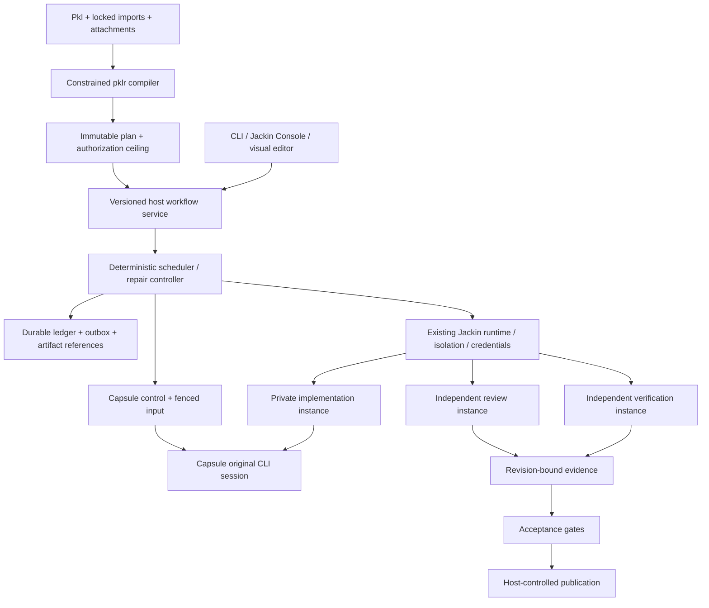

# System boundaries, invariants and crate ownership

**Status:** Proposed normative architecture implementing the supplied product specification. MUST denotes a release-blocking contract; SHOULD denotes a default whose exception must be explicit and auditable. This document describes target behavior, not current shipped APIs.

## Product boundary

Jackin owns the deterministic workflow plan, authorization, orchestration, evidence and publication decision. Real coding-agent CLIs own their agent behavior. Capsule owns the original terminal process, PTY, rendering and input routing. The plan does not make model outputs deterministic; it makes permissible transitions and acceptance decisions deterministic for a given set of recorded evidence and operator decisions.

A role is a reusable environment definition. A block is a unit of workflow behavior. A runtime instance is a provisioned isolation boundary. A logical workflow session may survive a vendor conversation resume, but every physical process/Capsule epoch must remain separately identifiable. These concepts must not be collapsed into one “agent” identifier.

## Host and worker topology

The diagram is descriptive. Dependencies and transitions are defined by the immutable plan and contracts, not by a rendered graph.

## Mandatory invariants

| Invariant | Rule |
|---|---|
| I01 — Frozen execution | A run references one immutable plan. Editing source, role defaults or workspace configuration cannot silently change it. |
| I02 — Host authority | Effective permissions never exceed host authorization. Agents, lower-precedence role files and operator prompts cannot widen them. |
| I03 — One writable owner | Concurrent mutable workers use independent instances and repositories unless a specifically authorized shared-state arrangement is declared. |
| I04 — Original session | Interactive agent work remains attached to the original Capsule-managed CLI/TUI, not a reconstructed terminal or proxy simulation. |
| I05 — Fenced input | At most one authorized input owner controls a session at a time; every automated and manual ingress checks the current lease generation. |
| I06 — Evidence before success | PTY readiness, agent narration, process exit and vendor turn completion are not implementation acceptance. |
| I07 — Immutable verification target | Tests and reviews bind to a host-sealed checkpoint and trusted verification-policy digest. |
| I08 — Latest candidate | Acceptance and publication compare-and-set the current candidate; newer revisions invalidate old eligibility. |
| I09 — Bounded repair | Every repair iteration, infrastructure retry and external-effect retry has a durable bounded counter and deadline. |
| I10 — Durable intent first | Persist a state transition and external-effect intent before dispatch; reconcile uncertain outcomes rather than blindly repeat them. |
| I11 — No silent prompt duplicate | Unknown delivery blocks automatic resend unless an adapter can prove safe deduplication or absence of application. |
| I12 — Preserve unique work | Normal cancellation, failure, expiry, prune and cleanup cannot destroy the only retained copy of incomplete or unpushed work. |
| I13 — Publish is separate | Checkpoint backup, implementation acceptance, PR publication and merge are distinct authorities and records. |
| I14 — Safe diagnostics | Audit content and replay are protected artifacts; raw prompts, terminal bytes, paths and secrets never become general telemetry. |
| I15 — Compatibility | Existing manual launch, roles, workspaces, Console and Capsule behavior stays supported through versioned/additive integration. |

## Proposed crate placement

| Location | Responsibility and dependency direction |
|---|---|
| `crates/core/jackin-workflow-spec` (new) | Serializable domain types, Pkl-facing schema, diagnostics and graph/plan validation. No runtime, UI or database dependency. Split heavy evaluator integration into a feature/module or adapter crate if dependency rules require it. |
| `crates/services/jackin-workflow` (new) | Pure transition logic, scheduler and repair coordination. Depends on domain types and abstract service ports; never owns PTYs or Docker flags. |
| `crates/services/jackin-workflow-store` (proposed new) | Workflow database migrations, transaction/outbox implementation and artifact metadata through workspace turso. This is the storage layer named in the product specification. |
| Existing `jackin-protocol` | Versioned wire envelopes and Capsule workflow-control extensions. Depends only on appropriately low-level types, not on the orchestrator. |
| Existing runtime service family | Adapter implementing `ExecutionPlatform`; reuse launch, image, credentials, backend and lifecycle functions. |
| Existing `jackin-isolation` | Private repository preparation, checkpoint-safe materialization and preservation-aware cleanup primitives. |
| Existing `jackin-capsule` app | Original session/PTY ownership, durable input receipts, input leases, observation and capture. |
| Existing host daemon composition | Owns workflow supervision and constructs store/runtime/adapter implementations. Do not place daemon ownership in `jackin-host`, which is desktop integration. |
| Existing `jackin` app and `jackin-console` | Thin clients and UI projections of the workflow service. |
| Optional web authoring package | Graph editor and source views using the same service, not another engine. |

Exact extraction into additional leaf crates must follow the repository’s allowed-dependency rules. The logical components in this pack do not require one crate each. A service port breaks a dependency cycle; copying a runtime function into a workflow crate does not.

## Trust boundaries

Treat workflow Pkl, repository contents, test commands, agent output, review findings, attachments and terminal escapes as untrusted data. Trusted enforcement is the host policy, approved runtime/Capsule binaries, verified backend boundary and signed or host-authenticated worker-control channel. A reviewer is independent evidence, not a security authority. A malicious test can execute arbitrary code inside its sandbox; it must never obtain publisher credentials or host execution rights.

Trusted role/image selection is resolved before workflow execution. Build-time hooks and installers are not allowed to run arbitrary host code under the guise of “planning.” Immutable image digest plus mutable host-mounted agent binary is insufficient: record and enforce the binary digest as well.

## Scope and exclusions

Final v1 includes every supplied block category, complete local durability, certified Docker behavior, conditional Apple Container support, same-session feedback, live control, replay, Console graph and visual authoring. Providers that cannot enforce a requested guarantee must reject that request. Supporting an extension interface does not imply every KVM/microVM provider is implemented.

Distributed scheduling, multi-host consensus, automatic merges, dynamic unbounded agent-generated graphs, arbitrary downloaded plugin execution and replacement agent frameworks are excluded. No exclusion removes one of the user’s fourteen final acceptance criteria.

## Evidence and references

- **J02 — [Cargo workspace](https://github.com/jackin-project/jackin/blob/453bf611fd974ff88f18caa97aa225af1f8edb2c/Cargo.toml).** Workspace members and package metadata inspected. Version 0.6.4; layered apps/core/services/adapters/ui directories; no workflow crates in the inspected member list.
- **J05 — [Runtime public integration surface](https://github.com/jackin-project/jackin/blob/453bf611fd974ff88f18caa97aa225af1f8edb2c/crates/services/jackin-runtime/src/lib.rs).** Full file. Existing launch, inspect, spawn, attach and cleanup re-exports; reactive daemon feature boundary.
- **J07 — [Shared Capsule contracts](https://github.com/jackin-project/jackin/blob/453bf611fd974ff88f18caa97aa225af1f8edb2c/crates/core/jackin-protocol/src/lib.rs).** Lines 1–280. Session capability and identity environment, scoped credential contracts, CapsuleConfig and exit preservation choices.
- **J08 — [Capsule control protocol](https://github.com/jackin-project/jackin/blob/453bf611fd974ff88f18caa97aa225af1f8edb2c/crates/core/jackin-protocol/src/control.rs).** Lines 1–280. SessionSend writes literal bytes; SessionSent acknowledges PTY writer delivery; Events is a subscription. Not an exactly-once prompt protocol.
- **J10 — [Host daemon shell](https://github.com/jackin-project/jackin/blob/453bf611fd974ff88f18caa97aa225af1f8edb2c/crates/services/jackin-runtime-host-daemon/src/host_daemon.rs).** Lines 1–260. Protocol version 2; Hello, Status, TelemetryHealth, AttentionSnapshot and Shutdown request variants. Not a workflow RPC service.
- **J11 — [Host desktop integration crate](https://github.com/jackin-project/jackin/blob/453bf611fd974ff88f18caa97aa225af1f8edb2c/crates/services/jackin-host/src/lib.rs).** Full file. Clipboard and desktop integration; not the daemon ownership location despite its name.
- **J14 — [Git isolation public surface](https://github.com/jackin-project/jackin/blob/453bf611fd974ff88f18caa97aa225af1f8edb2c/crates/services/jackin-isolation/src/lib.rs).** Full file. Existing materialization, finalization, cleanup, state and safe-removal boundaries.
- **J17 — [Existing sealed agent runtime trait](https://github.com/jackin-project/jackin/blob/453bf611fd974ff88f18caa97aa225af1f8edb2c/crates/core/jackin-core/src/agent/runtime.rs).** Lines 1–260, including the complete trait. Installation, auth and state behavior, not workflow-turn control. Built-in adapter count in comments is stale; no count inferred from it.
- **J18 — [Engineering rules](https://github.com/jackin-project/jackin/blob/453bf611fd974ff88f18caa97aa225af1f8edb2c/ENGINEERING.md).** Full document. Rust-first, reuse, turso general-purpose DB, governed jackin-telemetry and privacy rules.
